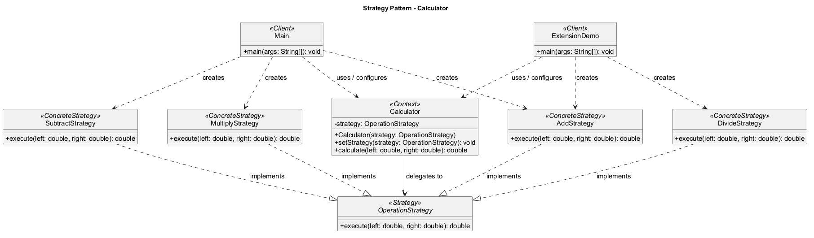

# Assignment 5: Strategy Pattern

Group: SE-2538

## 1. Introduction

The selected domain is a calculator (option B). Its family of interchangeable
algorithms consists of addition, subtraction and multiplication, with division
added as an extension. All operations accept two `double` operands and return
one `double` result.

`OperationStrategy` defines the common contract. `Calculator` stores a strategy
and delegates calculation to it. The client chooses an implementation and can
replace it through `setStrategy` while the program is running. `Main` uses one
calculator for all three initial operations and then switches back to addition.

## 2. UML class diagram



The context has an association with the interface, not a dependency on concrete
algorithms. The dashed hollow-triangle arrows represent interface realization.
Every connection is labeled: clients create concrete strategies, use the context,
and configure its behavior; the context delegates to the strategy interface,
which each concrete strategy implements.

## 3. Clean Code principles

### 3.1 Replace operation-selection conditionals with polymorphism

A hypothetical monolithic calculator would inspect an operation code in an
`if/else` or `switch` chain. Adding an operation would require editing that chain.
The implemented context instead delegates through one method:

```java
// Calculator: dynamic dispatch selects the current implementation.
public double calculate(double left, double right) {
    return strategy.execute(left, right);
}
```

There are no strategy-type checks in the context. The guard against a zero
divisor is input validation inside an algorithm, not strategy selection.

### 3.2 Use intention-revealing names

```java
Calculator calculator = new Calculator(new AddStrategy());
calculator.setStrategy(new SubtractStrategy());
```

`Calculator`, `AddStrategy`, `SubtractStrategy` and `setStrategy` communicate
their roles without numeric operation codes. `left` and `right` preserve operand
order, which matters for subtraction and division.

### 3.3 Give each strategy a single responsibility

```java
public final class MultiplyStrategy implements OperationStrategy {
    @Override
    public double execute(double left, double right) {
        return left * right;
    }
}
```

This class only multiplies. It does not read input, format output or select
another algorithm. Console output belongs to the client. Each strategy can
change for an algorithm-specific reason without affecting presentation code.

### 3.4 Depend on the abstraction

```java
private OperationStrategy strategy;

public Calculator(OperationStrategy strategy) {
    this.strategy = Objects.requireNonNull(strategy, "Strategy must not be null");
}
```

The context receives its dependency rather than constructing a concrete
strategy. It knows only the `execute` contract, so another implementation can
be supplied without introducing a dependency on its concrete class.

### 3.5 Extend behavior without modifying stable classes

```java
// ExtensionDemo: select the newly added implementation.
calculator.setStrategy(new DivideStrategy());
System.out.println(calculator.calculate(12.0, 4.0));
```

The division commit adds `DivideStrategy` and a new client, `ExtensionDemo`.
It does not edit `Calculator`, the interface, the three existing strategies or
`Main`. This is a concrete demonstration of the Open/Closed Principle. Selecting
a new operation still requires client configuration; classes are not discovered
automatically.

### 3.6 Encapsulate a valid context state

```java
public void setStrategy(OperationStrategy strategy) {
    this.strategy = Objects.requireNonNull(strategy, "Strategy must not be null");
}
```

The strategy is private and cannot be replaced directly. Both construction and
replacement reject `null`, so a successfully constructed context always has an
algorithm. A failed replacement preserves the previous strategy.

## 4. Strategy vs. State

Strategy represents alternative algorithms for the same task. Here, the client
chooses how to calculate a result; addition, subtraction and multiplication are
independent alternatives. State represents behavior determined by an object's
current lifecycle state, often with defined transitions, such as an order moving
from draft to paid to shipped. A calculator does not enter multiplication because
addition completed or a lifecycle transition occurred. Therefore Strategy fits
the problem. Both patterns use composition and delegation; their intent and the
meaning of behavior changes distinguish them. A public setter alone does not
determine which pattern a design uses.

## 5. Conclusion

Strategy keeps `Calculator` small and allows runtime replacement and independent
extension of algorithms. The cost is an interface and several small classes,
which can be excessive for a tiny calculator but make this assignment's
separation of responsibilities explicit.

The code was compiled with JDK 21.0.10 using `--release 17 -Xlint:all -Werror`.
Both demonstrations run successfully, showing runtime switching and division
error handling. The generated classes target Java 17. The example follows normal
`double` rounding and overflow behavior.


## 6. Link to the GitHub repository

[GitHub repository](https://github.com/bigstep832/assignment-5-strategy-calculator)
